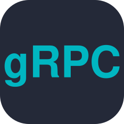
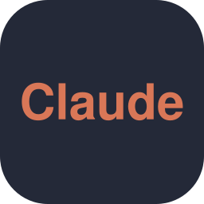
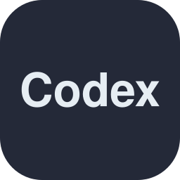

  

  <b>English</b> · <b>Русский</b> – every section is in both languages / каждый раздел на двух языках

## 👋 About · Обо мне

<table>
<tr>
<td width="50%" valign="top">

🇬🇧 Backend developer: I take tasks from the database and backend all the way to the interface.

- **Go** is my main language: microservices, gRPC/REST, high load, security.
- **React + TypeScript** for the frontend of my own services: Vite, Tailwind, TanStack Query.
- **C++** – basic understanding.
- **Python** for scripts and computer vision.

</td>
<td width="50%" valign="top">

🇷🇺 Backend-разработчик: делаю задачи, от баз данных и бэкенда до интерфейса.

- **Go** – основной язык: микросервисы, gRPC/REST, высокие нагрузки, безопасность.
- **React + TypeScript** – фронтенд к своим сервисам: Vite, Tailwind, TanStack Query.
- **C++** – базовое понимание.
- **Python** – скрипты и компьютерное зрение.

</td>
</tr>
</table>

## 🛠 Stack · Стек

| | |
|---|---|
| **Backend** |     |
| **Frontend** |      |
| **Data · Данные** |     |
| **Infra · Инфраструктура** |      |
| **Tools · Инструменты** |       |

## 📫 Contact · Контакты

